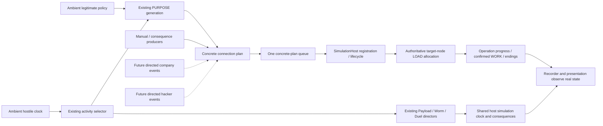

# Connections — traffic sources and common execution

November 22, 2026. Architecture map for the exploratory Congestion & Ambient Traffic V1 branch, based on PR #125. This describes the implemented Connections prototype and preserves intended future responsibilities; it does not authorize a Level Director or select a permanent ambient model. Packet has its own traffic/tick implementation.

## Sources and responsibilities

| Source | Status / owner | Responsibility | Execution path |
|---|---|---|---|
| Ambient legitimate business | Implemented, `ConnectionTrafficDirector` | Generate ordinary seeded PURPOSE requests. Temporary research policies compare actual population, independent exponential requests and nominal expected occupancy. | `GenerateBenignPlan` → concrete `ConnectionSpawnPlan` → `QueueSpawnPlan` |
| Directed company activity | Future design intention | Authored business events, changing demand, company-specific priorities and bursts. Separate from ordinary ambient request generation. | Intended to construct ordinary plans or modify ambient settings through an explicit future seam; no scheduler/planner is implemented here. |
| Ambient hostile activity | Implemented, director's independent hostile opportunity clock → `HostileActivityDirector` | Choose ordinary LOADER/INFECTOR, reconnaissance, Payload, Worm, launcher, direct Duel or carrier Duel from current weights. | Connection-producing choices use the common queue. Moving Payloads, Worms and direct Duels use their existing entity directors and the host's simulation clock. |
| Hacker targeting preferences | Implemented, `HackerDirectives` / `HackerDirectiveSelector` | SPREAD/BREACH preferences influence legal targets of an existing ambient opportunity. | Modify eligible target choice before ordinary dispatch. This is not a separate attack-arrival clock or a fully scripted hacker-event system. |
| Directed hacker events | Future design intention | Authored attacks, escalation and coordinated encounters, distinct from ambient hostile selection. | Intended to reuse connection plans and existing entity spawn/encounter APIs. No Level Director, event language or second simulation is added. |
| Consequence-generated activity | Implemented, infections and reconnaissance follow-ups | Existing Spawner children, Payload Spawner activity and delayed reconnaissance consequences. | `QueueSpawnerChild` / follow-up plans feed the common queue; existing moving entities retain their own lifecycle. These are consequences, not extra ambient business demand. |
| Developer/manual inputs | Implemented, terminal and witnesses | Explicit reproducible spawns and diagnostic fixtures. | Existing purpose builder/queue or existing entity APIs. Controlled LOADER fixtures register an explicit ordinary definition to avoid consuming generator IDs/RNG. |

## Shared execution authority

The queue orders concrete arrivals, not hypothetical customer jobs. Registration can enter Connecting and later cancel on an unavailable route. Neither registration nor nominal expiry earns WORK. The host owns allocation, operation completion, credits and ending precedence; producer callbacks and rendering do not recreate those rules. Physical links remain route geometry, not new resource constraints.

## What this experiment changes

Nominal occupancy is a small alternative input to the existing ambient coverage response. A generated request reserves one expected population slot until its planned time plus route travel and the sum of authored operation WORK/LOAD durations. Actual completion, cancellation, kill, infections and Overclock do not revise that expiry or trigger replacements. Opportunities remain stochastic and generated incrementally; there is no full-shift preplanning requirement. Recording distinguishes this expected count from actual active/connecting counts.

Research LOAD/headroom/concentration variations are explicit settings in the witness and review record, not new traffic-source responsibilities. The original actual-population policy remains the scene default, and historical PR #125's independent policy remains a disposable comparison. After the research decision, remove unused scheduling branches from the same director instead of maintaining three permanent gameplay modes. Common builders, queue, allocation and accounting need not change.

A future Level Director should remain free to change ambient demand and introduce separate authored company/hacker events. This prototype currently requires restart after editing experimental policy/tuning; it does not pretend to supply that future live-control API. Future work should define how an intentional demand change treats already-created nominal reservations, without tying them back to actual congestion or silently replacing killed legitimate jobs.

The broader [level/run design](../Design/level-and-run-structure.md) and [event proposals](../Design/events.md) retain their original intent and Packet-era examples. Current Connections has immediate quota success plus deadline/CORE failure from #124; this map does not silently replace those rules with the older survival-only design or import tick-based event timing.
