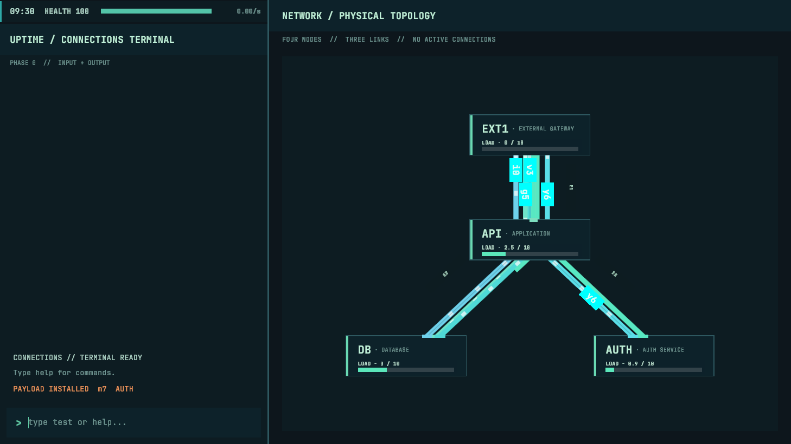

# Connections Ambient Population V1 — playtest amendment

## Final canonical WORK tuning

After the population-ramp comparison below, all six built-in canonical PURPOSE profiles doubled their normal-operation mean WORK. Requested LOAD, purpose weights, ±25% WORK spread, and the coverage controller stayed unchanged. A fixed-seed rerun used the same 0.2-second samples. The comparison here is **ramped PR #40 before WORK tuning → after WORK tuning**.

| Seed 1701, normal generation | Mean before → after | Peak before → after | Time at ≥5 before → after |
|---|---:|---:|---:|
| 0–30 s | 0.72 → 0.85 | 1 → 1 | 0% → 0% |
| 30–60 s | 2.11 → 2.55 | 3 → 3 | 0% → 0% |
| 60–90 s | 1.03 → 2.78 | 2 → 3 | 0% → 0% |
| 90–180 s | 0.12 → 1.04 | 2 → 5 | 0% → 2.4% |

The other normal-run 0–30-second peaks stayed **2, 1, and 3** for seeds 456, 90210, and 42. At 30–60 seconds, their peaks changed **3→5, 2→2, and 3→3**. Ordinary hostile plan counts through 600 seconds remained **13, 10, 13, and 10** across the four seeds. Later outcomes diverge because each generated connection lives longer.

In the seed-1701 **healthy 600-second run** with hostile generation disabled, mean established benign occupancy rose **3.15→5.10**, peak **6→8**, time at ≥5 **10.5%→70.8%**, and the longest uninterrupted ≥5 stretch **27.2→272.6 seconds**. In its 90–180-second window, mean was **3.01→4.30** and time at ≥5 was **15.1%→39.6%**. The controller continues to produce a low opening without a 0–30-second surge, but it does **not** keep sustained healthy occupancy near its goal of 3 with these longer lifetimes. This is a final review caveat; no compensating population or WORK-rate change is included.

Unity 6000.3.11f1 compiled the amended source. Traffic, Recorder, Resource, Network Health, Lifecycle, and Infection Witnesses passed. The image below was captured for the earlier ramp amendment, before this WORK tuning; it is retained as ramp review evidence, not a visual validation of the longer lifetimes.

This 1458×820 (approximately 16:9) frame was captured in rendered Unity 6000.3.11f1 **Editor Play Mode** from an isolated project copy. Randomize Seed was off, Seed was 1701, and an Editor script advanced the host by 300 fixed 0.1-second steps after Play initialization. It reported two runtime connections at 30.14 seconds. The network heading's “NO ACTIVE CONNECTIONS” is static authored copy. This automated capture checks rendering, not interactive terminal input, inspection, focus, or player action. Those still need manual 16:9 Editor review.

## Deterministic population comparison

The pre-amendment PR #40 branch and amended branch used the same scene, seeds, 0.2-second simulation steps, and 600-second horizon. Counts below are **established benign** connections after each step; Connecting and queued attempts are excluded from occupancy but inform the controller. No player commands were issued. Normal runs retain hostile generation, so later Blackout can prevent establishment.

| Seed 1701, normal generation | Mean before → after | Peak before → after | Time at ≥5 before → after |
|---|---:|---:|---:|
| 0–30 s | 3.25 → 0.72 | 5 → 1 | 37.3% → 0% |
| 30–60 s | 4.85 → 2.11 | 7 → 3 | 56.7% → 0% |
| 60–90 s | 1.69 → 1.03 | 3 → 2 | 0% → 0% |
| 90–180 s | 0.41 → 0.12 | 5 → 2 | 2.0% → 0% |

Other normal-run opening peaks (0–30 / 30–60 / 60–90 / 90–180 seconds) changed from **4/4/2/2 to 2/3/1/3** for seed 456, **3/4/4/4 to 1/2/2/1** for seed 90210, and **6/6/4/0 to 3/3/3/0** for seed 42. The ordinary ambient hostile plan counts over 600 seconds remained **13, 10, 13, 10** respectively before and after. The extra coverage plans changed network outcomes, so identical ordinary draws do not imply identical later Health or infections.

For a healthy-network 600-second test, seed 1701 used `hostileChance = 0` while retaining ordinary benign arrivals. Mean occupancy changed **3.63 → 3.15**, peak **7 → 6**, time at ≥4 **49.1% → 41.0%**, and time at ≥5 **22.3% → 10.5%**. The longest uninterrupted ≥5 stretch was **27.4 → 27.2 seconds**. This still permits natural crowding; the controller is not a hard cap. During 90–180 seconds in that healthy run, time at ≥5 fell **37.1% → 15.1%** and the peak fell **7 → 6**. Zero-benign time over 600 seconds was 0.7% in both runs.

## Recovery and validation

The Traffic Witness now checks the 1→3 ramp, skipped opportunities at high population, imminent versus far-future queued plans, unchanged ordinary seeded plans, canonical purpose weighting, deterministic replay, and the Blackout recovery path. A deliberately canceled benign attempt produces bounded retry timing during Blackout; cleaning the node clears cancellation pressure and advances the next coverage opportunity to about one simulated second. The Recorder Witness checks the saved configuration and the opportunity's effective goal, roll, chance, and linked complete queued plan. Traffic, Recorder, Resource, Network Health, and Lifecycle Witnesses passed in the isolated Unity project; compilation passed. The healthy 600-second measurement is an automated Edit Mode simulation, not interactive Play Mode validation. Manual review should confirm arrival rhythm, path labels, terminal focus, and cleaning during a live Blackout at 16:9.
