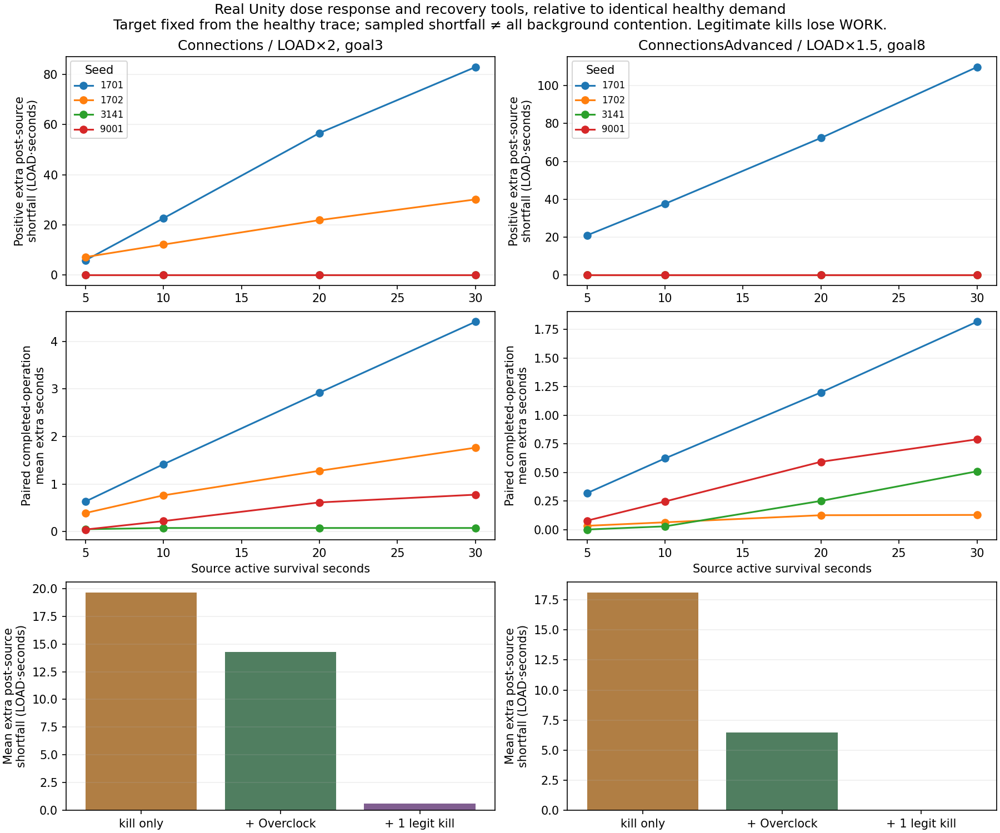
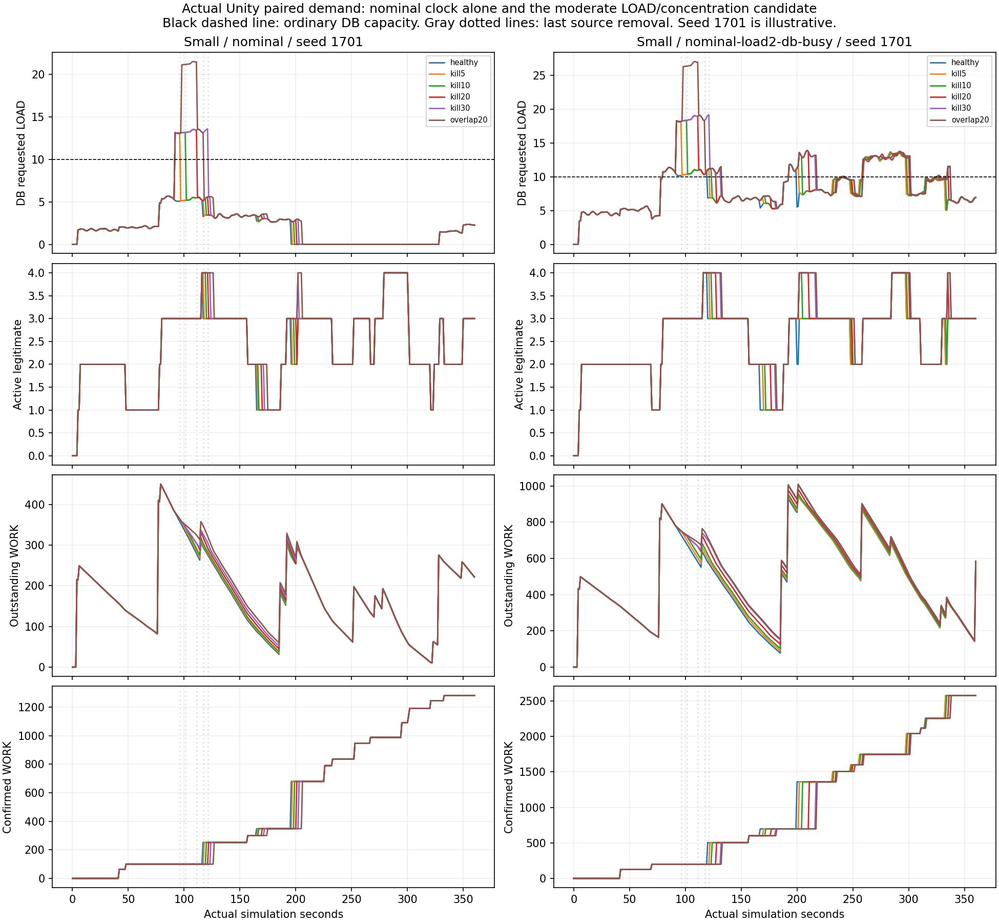

# Results — what creates recoverable congestion?

**Keep nominal occupancy as a research candidate; revise workload/quota tuning before adoption.** The unmodified nominal policy solves the demand-feedback problem but does not create the desired pressure by itself. Moderate LOAD and destination concentration produce a partial positive result: source-caused lingering pressure in two of four Small seeds, and one of four Advanced seeds at the higher-concurrency point. Existing tools can improve those cases at modest connection counts. Effects remain seed-sensitive, and ordinary source-only runs still recover enough to match healthy confirmed WORK by the diagnostic deadline. The unchanged quotas often finish earlier, rather than becoming meaningfully endangered.

The evidence contains **338 actual Unity runs**, not the external Python sandbox: 272 controlled diagnostic runs, 30 quota-enabled controlled runs, and 36 mixed-threat shifts. [Tables](tables.md), [all per-run rows](runs.csv), [raw suite files](README.md#evidence) and [definitions/caveats](VALIDATION.md) preserve negative results and real CORE truncations.

## Nominal first, then focused variations

Untuned nominal occupancy was tested first with current recipes and goals. In 24 runs across both scenes/two seeds, killing sources after 5/10/20/30 active seconds or overlapping two sources produced **zero sampled additional post-removal shortfall** versus the same healthy schedule. Small healthy peaks were four active legitimate jobs; Advanced five. Slow jobs have too little competing target demand to turn ordinary delayed WORK into a cascade.

The population and #125 independent controls agree with the earlier finding: matched-volume independent demand has little tail; faster independent demand creates substantial healthy/background congestion. These controls use two seeds each here; #125's original four-seed evidence is preserved separately.

Five tuning probes kept normal per-operation WORK/LOAD duration approximately unchanged:

- LOAD×3, with original goals: a healthy Small seed loses CORE. Lowering the expected goal to 2.5/3 creates more nominal headroom but does not cure that seed's excessive individual/burst demand. Reject these as starting balance settings.
- LOAD×2 with expected goals6/8: considerably more background contention; a long post-kill window can simply be the healthy burst already in progress. Increased volume alone is insufficient evidence of attack damage.
- LOAD×2 plus DB-purpose weight×2.5 at default goals3/4: more useful Small behavior with low counts and no healthy Integrity damage in the four-seed follow-up.
- LOAD×1.5, DB-purpose weight×2, expected goals6/8: higher concurrency; Small can be too busy in a seed, while Advanced is a better follow-up candidate. Its four-seed targeted follow-up uses Advanced goal8 only.

Concentration favors existing purposes whose actual scene destination is DB. It preserves all routes and operation arcs. Advanced's inventory and export tasks go to JOBS and RPT; increasing their legacy catalog weights would not concentrate DB demand. Benign-only weight controls preserve hostile selection/recipes, verified deterministically.

## Source-caused pressure, separated from background

The four-seed follow-ups use an ordinary **8-LOAD** steady LOADER, not the earlier 12-LOAD fixture. The source is introduced around90 seconds; survival is measured from real activation after Connecting. Overlap adds an identical source five seconds after the first activates. In follow-ups, the target is fixed from the busiest legitimate node in the **healthy** 90-second sample, then reused across attack/tool cases. This is an explicit controlled vulnerability probe, not a new hostile AI or a claim about typical ambient target choices. Earlier screens use fixed DB.

| Follow-up | Healthy mean contention | Healthy peak active | Healthy Integrity / CORE damage | Seeds with additional post-removal pressure |
|---|---:|---:|---:|---:|
| Small: LOAD×2, DB weight×2.5, goal3 | 10.2% | 4 | 0/4 / 0/4 | 2/4 |
| Advanced: same moderate point, goal4 | 2.5% | 6 | 0/4 / 0/4 | 0/4 |
| Advanced: LOAD×1.5, DB weight×2, goal8 | 11.8% | 10 | 0/4 / 0/4 | 1/4 |

Affected seeds show a clear survival-duration relationship. The table reports **positive extra shortfall after the last source disappears**, in LOAD·seconds, relative to identical healthy demand. It is not all later background contention. Values are approximately one-second reductions of real traces.

| Seed1701 case | 5s source | 10s source | 20s source | 30s source | Two overlapping20s sources |
|---|---:|---:|---:|---:|---:|
| Small moderate point | 5.8 | 22.6 | 56.7 | 83.0 | 91.7 |
| Advanced higher-concurrency point | 20.9 | 37.6 | 72.4 | 109.8 | 120.3 |

Small seed1702 also shows additional shortfall; Small3141/9001 and Advanced1702/3141/9001 do not. Some targets have little suitable work left when the source dies even if they were busiest at90 seconds. No guaranteed crisis or exponential runaway is established.

For Small1701, additional post-removal contention grows from approximately10 seconds after a10-second source to38 seconds after a30-second source, and43 seconds after the overlap. Advanced1701's corresponding increases are10,32 and34 seconds. Its longest continuous extra-shortfall interval reaches19 seconds after a10-second source and29 seconds after overlap. Paired completed-operation mean extra execution time increases from1.42s to4.41s in Small for10→30s survival; Advanced from0.62s to1.82s. These means include unaffected paired completed operations and censor incomplete ones.

First quiet timestamps are easy to misread. Advanced1701's 10-second source gives a44.7-second post-removal wait for a ten-second no-shortfall window, but the healthy trace already waits about41.8 seconds from that boundary. The actual incremental burden is the matched difference above, not44.7 seconds of entirely attack-caused overload. Relative recovery delays can shrink for a longer-lived source simply because removal happens later; absolute timelines and dose metrics are retained.

## Tools, workload debt and WORK at risk

Existing Overclock is useful where demand remains above capacity. In Small1701 after a20-second source, it reduces positive extra post-source shortfall from **56.7 to35.3 LOAD·s**, and additional contention samples from25 to3. In Advanced1701 it reduces extra shortfall from **72.4 to25.9 LOAD·s**. The first quiet window opens immediately, but ordinary-capacity recovery can occur later; the raw metrics retain both. In seeds with no remaining competition, Overclock often changes nothing because jobs already receive their full desired LOAD.

Selective legitimate `kill` can remove the bottleneck more decisively. In Small1701 the diagnostic policy sacrifices one high-demand, low-progress known legitimate job: extra shortfall falls to2.4 LOAD·s, but **662.3 confirmed WORK is foregone by the deadline**. Advanced1701 sacrifices218.1 WORK. Other seeds sometimes have no eligible victim, so no kill occurs. This is a pressure/productivity tradeoff, not a free recovery improvement or a demonstrated human classification policy.

Delayed workload can outlive LOAD overload. Advanced1701's extra outstanding WORK after a10-second source takes about162 seconds to return within1 WORK for five sampled seconds; Small's matching debt criterion remains unmet by the common endpoint. That does not mean continuous overload for that entire time. Once jobs receive their requested LOAD, spare capacity cannot accelerate them above that request. A delayed job can remain behind schedule until completion while newer jobs proceed normally.

All ordinary source-only cases in the two four-seed follow-ups still match their own healthy confirmed WORK at360 seconds. Delays are real, but the final productivity requirement is not substantially endangered in those recoverable settings. Credit arrives in whole operation-completion chunks: a large transient credit deficit is not permanently lost WORK. The CSV retains delay/credit areas, incomplete WORK and the explicit lost amount from shedding. Existing Integrity damage can persist after an attack's LOAD disappears; nothing repairs or suppresses it here.

## Current quotas and natural play

Actual six-minute targets remain Small900 / Advanced1,200. The controlled quota runs expose the supply change directly:

| Same seed / scene | Untuned nominal healthy | Tuned healthy | Tuned10s source | Tuned30s source |
|---|---:|---:|---:|---:|
| Small1701, moderate point | 252.1s | 199.2s | 204.6s | 216.2s |
| Advanced1701, moderate point | 307.6s | 238.3s | 238.3s | 238.3s |
| Advanced1701, higher-concurrency point | 307.6s | 150.4s | 154.3s | 161.4s |
| Advanced3141, higher-concurrency point | 312.8s | 143.5s | 143.5s | 150.0s |

These are genuine quota-enabled endings, not inferred crossings of the diagnostic trace. All30 controlled quota cases succeed. Scaling WORK with LOAD preserves lifetime but grants more confirmed WORK per operation; increasing nominal population also supplies more requests. Thus the quota's numerical meaning changes even though its accounting rule is untouched. Early success can conceal recovery, which is why the main experiments use an unreachable diagnostic target.

In the four-seed mixed sample, untuned nominal versus the moderate point succeeds in3/4 versus3/4 Small shifts and2/4 versus4/4 unattended Advanced shifts. Bounded visible defense raises untuned Advanced to3/4, while the moderate point remains4/4. Successful medians are about256s→189s Small and290s→210s Advanced unattended. Untuned Advanced has2/4 unattended CORE losses and1/4 under visible defense; the moderate point has none before its earlier ending. The higher Advanced point's smaller two-seed mixed check succeeds in both seeds around144–152s under either operator policy. **Earlier success censors hostile exposure; this does not prove threats became harmless.** No quota, enemy or CORE value was retuned to improve results.

## Density and decision

The useful Small point stays near the old connection-count experience: four active legitimate jobs at peak, though allocations/WORK are heavier. The higher Advanced point peaks at ten healthy active legitimate jobs and eleven under attack, much lower than some #125 high-rate traces. Limited actual Play Mode captures preserve readable short IDs, distinct physical/logical paths, structured inspect, input focus state, WORK/tools and the one-third terminal layout. They do not establish comfortable sustained play at all peak states, real keyboard/IME behavior or player judgment under mixed threats.

Keep the nominal demand decoupling, common pipeline and transparent recorder measures as research. Keep the two useful tuning points for human comparison. Revise the offered WORK/headroom/quota relationship and test more seed/timing variation before selecting a model. Discard the uniform LOAD×3 settings as starting balance and reject claims that nominal scheduling alone solves congestion. Do not add unrelated mechanics or merge anything to force a positive outcome.
