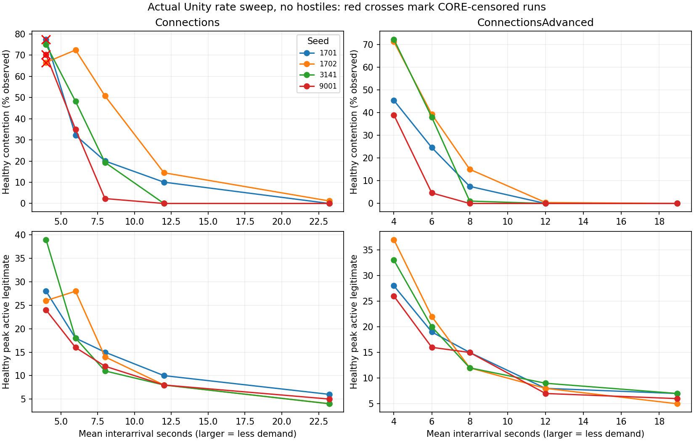
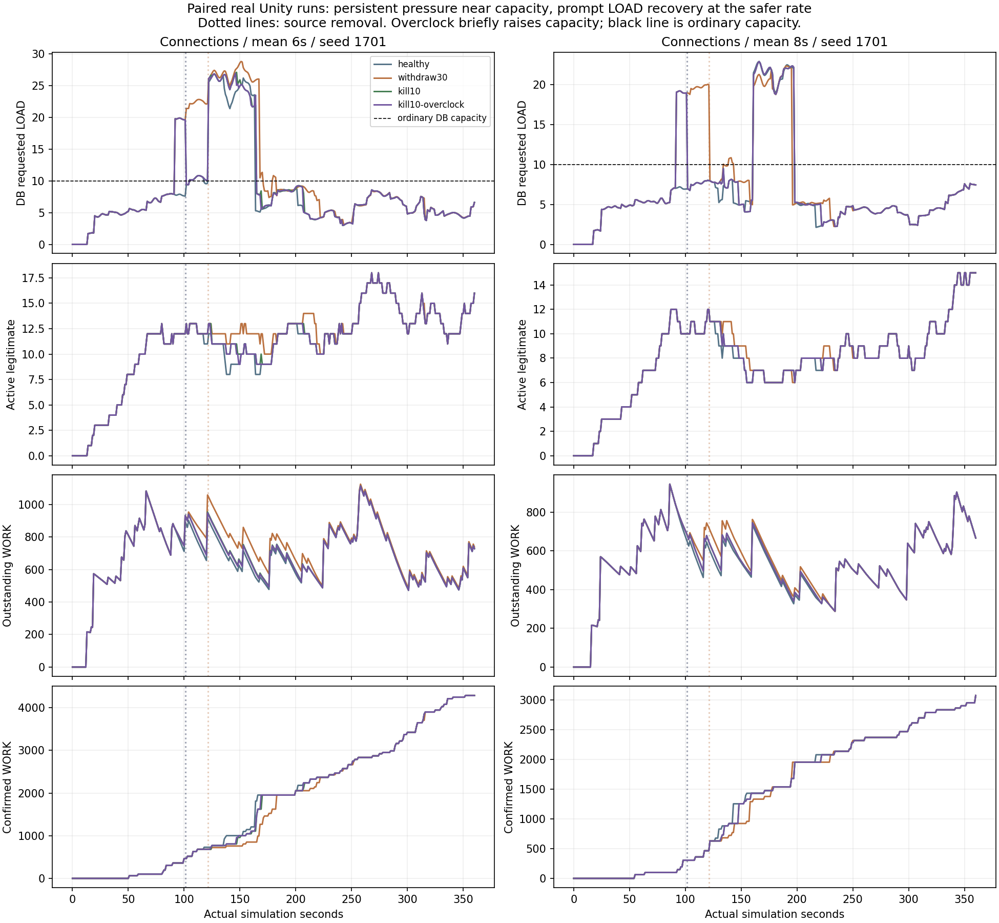

# Results and recommendation

**Revise / retain for human comparison. Do not adopt as canonical.** The scheduling change works and exposes offered-load pressure, but this constant-rate experiment does not establish the desired recoverable cascade after a ten-second threat on an otherwise comfortable network. Delayed WORK persists more readily than actual excess LOAD. Faster supply also allows the existing quotas to finish much earlier, often before hostiles have time to matter.

These are actual Unity results: 192 controlled runs and 48 natural quota-enabled shifts in both canonical scenes. Four controlled seeds per rate establish repeatability and variation; they are not a complete balance study. See [all measurement tables](measurement-tables.md), [192 per-run rows](controlled-summary.csv), [raw controlled traces](controlled-runs.json.gz), and [method/censoring definitions](VALIDATION.md).

## 1. Does pressure compound after a short disruption?

Independent scheduling removes occupancy feedback exactly as intended. Slowed connections do not reduce future request creation, and paired healthy/disrupted runs keep identical due times and benign plans until a real ending. All independent measured arrivals were admitted; waiting and unadmitted counts are zero. This is ordinary active WORK accumulation, not a separate admission queue.

However, much of the difference from the old policy is **more offered demand**. Population-responsive healthy runs average 15.5 requests in Small and 19 in Advanced over 360 seconds. Their empirical constant-rate matches are means **23.225807s** and **18.947369s**. Independent runs at those matched rates average 13.8 and 17.2 requests across these seeds, and have essentially no healthy contention or source-caused post-kill contention. Matching an expected rate does not force identical realized counts or recipes across the two policies.

At faster rates, healthy legitimate traffic alone already creates substantial pressure:

| Mean wait | Small healthy contention | Advanced healthy contention | Small / Advanced peak active |
|---|---:|---:|---:|
| 12s | 6.1% | 0.1% | 10 / 9 |
| 8s | 23.1% | 5.9% | 15 / 15 |
| 6s | 47.0% | 26.6% | 28 / 22 |
| 4s | 72.3% | 56.9% | 39 / 37 |

Contention is the mean fraction of observed time with legitimate LOAD shortfall. At 4s, three of four healthy Small runs end in CORE loss and censor observation; Advanced has no healthy CORE ending but every seed compromises at least one node. At 6s, three of four Small seeds take Integrity damage without a CORE ending. A lack of CORE loss does not establish a healthy baseline.

The rate sweep therefore supports the proposed negative-feedback explanation as a real control difference, but does not show that merely removing it at comparable volume creates a useful recovery game.

## 2. Does congestion persist after the original source is removed?

There is a real difference between **delayed workload** and **continued competition above capacity**.

- Small, mean8s: all four ten-second-kill cases immediately begin a ten-second no-shortfall window after removal. Relative to their identical healthy traces, outstanding WORK takes roughly **49–120 seconds** to return within 1 WORK for five sampled seconds. Yet the sampled additional post-removal global contention is **zero seconds in all four**. Old jobs can remain behind schedule while each receives its full requested LOAD.
- Advanced, mean6s: all four kill cases likewise immediately begin a no-shortfall window. Three retain a small extra workload at removal (about 2.8–5.2 WORK), clearing that difference in roughly **36–43 seconds**; the fourth has effectively none. Additional sampled post-removal contention is zero in all four.
- Small, mean6s, seed1701 is the apparent positive case: the first no-shortfall window begins **63.28 seconds** after a ten-second kill. But the same healthy run, measured from that removal boundary, remains busy for approximately **62.8 seconds** in the per-second trace. The paired run has only about **four extra global contention samples** after removal. Most of the visually long tail is background traffic, not a newly created cascade.
- Leaving that same source active for 30 seconds gives a 61.7-second post-removal wait and about eleven extra sampled contention seconds. Removal is twenty seconds later, so the shorter relative wait is not a faster intervention. Absolute removal times, total contention and extra workload are retained in the CSV.

Later ordinary bursts can contend after the first quiet window. That is why the evidence includes total post-removal contention, normal-capacity recovery, paired healthy traces and extra-work estimates rather than treating one recovery timestamp as a permanent return to health. One-second derived estimates are explicitly separate from the simulation-step integrals.

## 3. Can an operator substantially improve recovery?

Killing the LOADER after ten active seconds removes its real 12-LOAD demand twenty seconds before natural withdrawal, reduces interference while it is present and generally leaves less extra workload. That part works through the existing allocator and lifecycle.

Overclock is useful when the target is genuinely over capacity. In the Small mean6s/seed1701 case, kill plus Overclock opens an immediate quiet window and reduces post-removal contention from **100.44s to 88.60s**. The first quiet window **after capacity returns to normal** still begins around **63.1s**, close to kill-only's 63.3s. The extra WORK difference clears around 111.8s after removal with Overclock; kill-only does not meet the five-second near-zero-debt criterion before the 360s endpoint.

At the safer Small8s and Advanced6s settings, kill-plus-Overclock has no measured extra recovery benefit in the four controlled seeds: DB demand is already satisfied once the source is gone. Existing allocation caps each connection at its desired LOAD; more spare capacity does not accelerate a job that already receives its full request. Thus “more delayed jobs” does not automatically make Overclock a useful cleanup tool.

## 4. Can this happen without permanently overloading a healthy network?

The grid does not establish a robust setting satisfying the central test. Matched/low rates recover promptly. High rates generate pressure before any fixture, including natural Integrity damage and some CORE losses. Intermediate rates produce episodic competition and lasting WORK debt, but the measured long LOAD tails are largely already present in their healthy counterparts.

For **comparison playtests**, use the captured/natural trial **Small8s / Advanced6s**, with **Small12s / Advanced8s** as a gentler pair and **Small6s** as an explicit stress test. These are provisional test points, not a recommendation to ship a new canonical rate. The Inspector's independent mean remains 8s by default and the canonical policy remains population-responsive. Do not start at 4s or retune quotas/CORE merely to manufacture a positive result.

The next decision should follow human comparison: whether ordinary delayed WORK is itself meaningful trouble, and whether higher background density is welcome even without a strong source-caused overload tail. This branch adds no extra mechanic to force those answers.

## 5. What happens to visual density and playability?

Healthy controlled peaks grow from **4/5 active legitimate connections** under population response to **15/22** at Small8s/Advanced6s (the Advanced8s peak is 15). The natural trial reaches **26 visible logical connections in Small** and **23 in Advanced**, compared with baseline peaks 8/9 across both operator policies. At 4s, healthy active peaks reach 39/37; those are inappropriate assumptions for comfortable playability.

Sixteen actual Play Mode captures cover healthy, live LOADER, post-kill and post-expired-Overclock at 1920×1080 and 1280×720. The captured network still leaves approximately one-third terminal/two-thirds network, distinct paths/physical links, readable short IDs, structured inspect output, WORK strip and tools. `inspect` restores the input focus state. These captures occur at moderate density, **not the full measured peaks**. No claim is made that dozens of simultaneous labels remain comfortable under real keyboard play. Dense bundles, moving labels, command rhythm and history need human review.

## 6. What happens to #124's WORK quotas?

The actual quotas remain Small900 / Advanced1,200 in 360 seconds. Natural mixed-threat runs compare six seeds and two bounded operator policies:

| Scene / operator | Population successes | Independent successes | Population median success time | Independent median success time |
|---|---:|---:|---:|---:|
| Small / unattended | 3/6 | 5/6 | 262.15s | 165.54s |
| Small / visible defense | 4/6 | 5/6 | 278.88s | 164.06s |
| Advanced / unattended | 2/6 | 6/6 | 295.98s | 163.51s |
| Advanced / visible defense | 4/6 | 6/6 | 310.81s | 162.81s |

Baseline unattended CORE losses are 1/6 Small and 2/6 Advanced; bounded defense gives 0/6 and 1/6. Independent trial runs have no CORE ending before their own quota/deadline endpoint. **Earlier success reduces hostile exposure**, so those lower CORE counts do not prove independent demand makes threats harmless. One Small seed still fails quota under both independent policies; this is not universal automatic success.

The increased supply makes the quotas substantially easier to satisfy in this sample and compresses the room for operator benefit. An easy quota can conceal the very later recovery tail this task is testing. Diagnostic runs deliberately keep an unreachable quota, but do not disable real CORE failure. Default population behavior still reproduces all 18 original #124 quota checks exactly, including failure cases and exact credit prefixes.

Do not fold this into #124 or change its quotas on this evidence alone. Keep the small experimental seam, play both rates/policies, and decide explicitly whether to revise the demand model, keep only its simpler scheduling, or reject it. [Manual steps](README.md#human-unity-review) and [full limitations](VALIDATION.md) accompany the draft PR.
