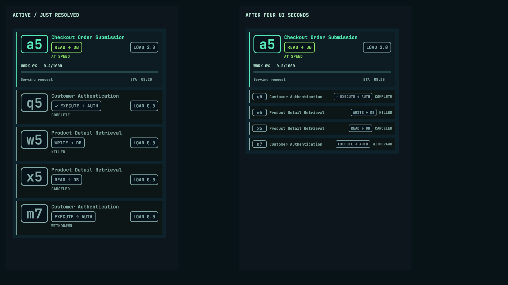

# Connections resolved inspection cards

This 1920×1080 Editor composition was rendered in Unity 6000.3.11f1 from an isolated copy using the authored inspection prefabs. The left column shows an active verbose card and immediately resolved cards. The right column shows the same active card and the four 48-unit summaries after four UI seconds. It is a layout preview, not an interactive Play Mode screenshot. The separate preview columns are for comparison; the terminal still displays its normal history.

`COMPLETE`, `KILLED`, `CANCELED`, and `WITHDRAWN` remain distinct. Only natural completion adds a final-operation checkmark. All summaries retain purpose, operation, muted styling, and the left accent, while removing LOAD and verbose details. The ID and operation pills reuse existing components/materials at smaller sizes. Active and immediately resolved cards retain the existing compact/verbose layouts.

## Validation performed

Unity compiled the isolated project and passed the existing Inspect V2 Witness and the new Resolved Inspect Witness. The latter checks real model examples for all four outcomes, cancellation before establishment, exact four-second UI holds, independent cards, fresh historical inspection, widths down to 272 units, unchanged simulation facts/time, history anchoring, bottom following, and unchanged prompt text/selection/focus.

A temporary automated Play Mode runner also passed with simulation time paused: an actual four-second unscaled hold, independently timed later resolution, exact killed labels, a visible second card anchored while the previous card shrank, and preservation of native input focus, selection, and draft. The runner and capture helpers remain outside the repository; the reusable deterministic witness is available at `Tools → Connections → Run Resolved Inspect Witness`.

The three existing [fitted-pill previews](../ConnectionsInspectPillFit/README.md) were re-rendered and compared byte-for-byte with their checked-in versions. All were identical, covering active and immediately resolved compact/verbose layouts. Final Unity log: `/private/tmp/uptime-resolved-inspect-final.log` (local validation artifact, not committed). The temporary Unity project emitted an existing SearchDatabase indexing `ArgumentOutOfRangeException` during Play startup; both witnesses and the Play Mode assertions completed, and Unity exited successfully.

## Interactive review still needed

At 16:9 in `Connections.unity`:

1. Inspect active connections in both default and verbose modes. Confirm the full card remains unchanged through operation transitions and immediately after resolution.
2. Let a multi-operation connection complete; kill another while active or connecting; inspect a canceled connection, including cancellation before establishment. Confirm each waits four seconds and keeps its exact outcome after shrinking. Inspect a withdrawn LOADER when available.
3. Inspect several IDs together and in separate commands. Resolve them at different times; confirm independent collapse. Reinspect historical IDs and confirm a fresh full-card hold without expanding earlier summaries.
4. Browse older history while cards above and inside the visible output shrink; also test bottom following and reading details that disappear. Confirm no unexpected jump, then type a draft and retain focus/selection through a collapse. Check PID-Select focus when open.
5. Toggle the expanded Health panel, resize the terminal, and check long purposes, narrow rows, and multi-connection network-label crowding. Confirm summary pills/text remain legible and aligned.

No simulation, command parsing, operation plan, allocation, completion/kill/cancellation/withdrawal semantics, Packet code, or scene settings changed.
