# Destination sockets — final focused refinement

The destination is now a larger, higher-contrast bullseye, using the existing shared marker composition. **Palette, ribbon/activity styling, heartbeat, deadlines, topology, lane/pill packing and inspect UI remain unchanged.** Draft PR #131 stays unmerged.

## Selected treatment and packing

The shared `ConnectionDisplay.prefab` authors **32-unit backing / 28-unit ring / 3.5-unit ring weight / 7-unit opaque dot**. Dark backing RGB is `(0.006, 0.016, 0.021)`. Compact ring weight is `min(3.5, current ring diameter × 0.18)`, keeping a visible dark annulus at reduced sizes. Ring and dot retain the connection's resolved identity/status color and departure opacity. The same nested marker is instantiated by gameplay and used by the permanent lab. No extra objects, assets, shaders or material clones.

The old shared rectangle was overridden to 18 units despite the component's 26-unit preference; the initial sizing fast path could retain the smaller rectangle. Packing also used every lane on the final link, including passing connections. The shared marker now synchronizes size on activation, and the existing presenter fits **visible destination sockets** against their actual boundary centers before Canvas geometry. Preferred diameter is capped by the nearest center distance minus **3 UI units**, never enlarging beyond available space. Departing sockets reserve room until retirement. Shrink is immediate; growth uses the existing relayout easing. The endpoint's boundary intersection and two-unit outset are unchanged.

An isolated socket and separated destinations can use all 32 units. Dense Small boundaries can still require diameters near 11 units; this pass strengthens their ring/dot contrast while avoiding overlap. The old forced 12-unit floor is disabled only for the shared marker, permitting smaller safe footprints in extreme packing. Legacy `TerminalMarker.prefab` and legacy behavior retain their settings.

## Focused before / after — actual Play Mode

Before images are the committed corrective pass **`a0ffc00de41abfd4fb4ac60c136bc9b76e73ed43`**, cases 01/02/11. After images replay the existing one/two/eight benign-request fixtures in Unity 6000.3.11f1 at the same three-second simulation point and both resolutions. The full source PNGs are retained alongside the crops; terminal history outside these crops can differ between the two capture sequences.

These are native, **unscaled pixel crops** around the DB boundary, taken from real full Play Mode renders. Crop coordinates come from the node's screen bounds and are saved in adjacent `*-crop.txt` files. No drawn annotations, interpolation or generated imagery. The frozen-host review fixture explicitly settles both endpoint and socket-size animation; it asserts the socket reaches the available diameter before saving.

| Scene / fixture / resolution | Before | After |
|---|---|---|
| Connections / ordinary / 1920x1080 | 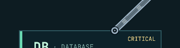 | 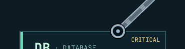 |
| Connections / ordinary / 1280x720 | 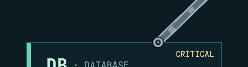 | 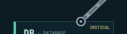 |
| Connections / paired / 1920x1080 |  | 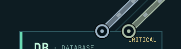 |
| Connections / paired / 1280x720 | 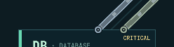 | 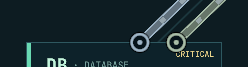 |
| Connections / crowded / 1920x1080 | 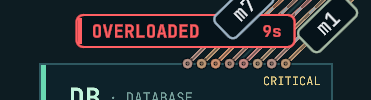 |  |
| Connections / crowded / 1280x720 |  | 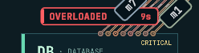 |
| ConnectionsAdvanced / ordinary / 1920x1080 | 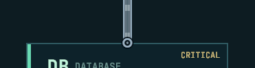 | 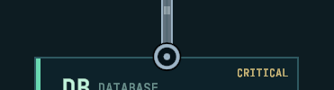 |
| ConnectionsAdvanced / ordinary / 1280x720 | 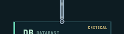 | 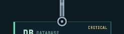 |
| ConnectionsAdvanced / paired / 1920x1080 | 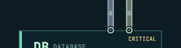 |  |
| ConnectionsAdvanced / paired / 1280x720 | 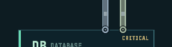 | 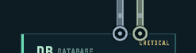 |
| ConnectionsAdvanced / crowded / 1920x1080 | 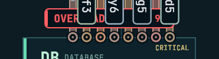 | 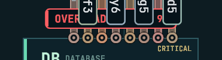 |
| ConnectionsAdvanced / crowded / 1280x720 | 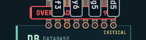 | 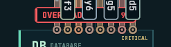 |

## Actual checks

- Unity 6000.3.11f1 compilation passed in the isolated project copy; the original Editor stayed open.
- [Socket semantic checks](deterministic-checks.txt): **52 PASS**. Both scenes, one/two/eight/sixteen requests, exact endpoint placement and status color, non-overlapping backings, immediate contraction, recovery from zero available space, and no unnecessary cap from transit lanes/different destinations.
- Existing integration **81 PASS + 2 scoped allocation probes unavailable**, lab **512 PASS + 1 unavailable**, Geometry witness PASS and canonical **883 PASS** were rerun with the refined shared prefab. Their raw focused/canonical reports retain the same counts. Scoped zero-allocation claims are not made.
- [Focused actual Play Mode](graphical-checks.txt): **204 PASS**, both scenes at 1920×1080 and 1280×720. **12 current full frames**, 12 committed before frames and 24 boundary crops. Settled sizes match measured available space, and every pair retains three-unit backing clearance.
- [Current lab evidence](Lab/): actual shared 32-unit socket in all existing curated examples; lab controls, bounds and hierarchy remain covered by the lab graphical runner. See its retained report.
- [Scope proof](isolation-checks.txt) records unchanged palette/style, heartbeat, adapter/danger formula, simulation, allocator, canonical scenes, progress shader/material, base legacy socket prefab and Packet scenes. Current Assets match the tested copy. Project Core regenerated from sources and checked; whitespace checked.

The broad suite was not rerun for this socket-only refinement. Its three known inherited failures remain preserved from the preceding corrective pass: Advanced Overclock compact row, Resource inspect-header pill geometry/color, and stale Generated Identity Small hostile-family weights/arrival expectation (later cases not reached). No unrelated tuning or expectations were changed. The initial QuickSearch indexing exception remains nonfatal during graphical startup.

## Deferred design notes

1. The current muted ordinary hues may imply mechanical categories. A later pass may prefer a narrower family of tinted slate greys, with stronger blue/teal identity variation reserved for priority. **No palette change here.**
2. Retain the future inspect-panel idea of a **moving deadline checkpoint on the existing WORK bar**, potentially replacing the two additional SERVICE diagnostic lines. Semantics still need design; **no checkpoint or inspect change is implemented.**

## Human review and reproduction

Open Small and Advanced at both resolutions. Use the existing Healthy, Slowed Safe and Benign Fragility fixtures, then ordinary generated traffic. Follow the ribbon toward its destination and confirm the socket is obvious even during READ's reverse activity. Compare isolated, paired and crowded boundaries, alias/Probe coloration, danger, arrival/relayout and departure. Native human acceptance and extreme-crowding readability remain review items.

Automated: `ConnectionVisualIntegrationWitness.Sockets` in batchmode/nographics/quit runs the semantic and relevant existing checks. `FragilityCapture.RunSockets` in graphical batchmode (omit nographics/quit) writes focused PNGs/crop coordinates and exits. `ConnectionDisplayLabCapture.Run` checks/captures the actual lab. Do not run the guarded one-time integration migration.
